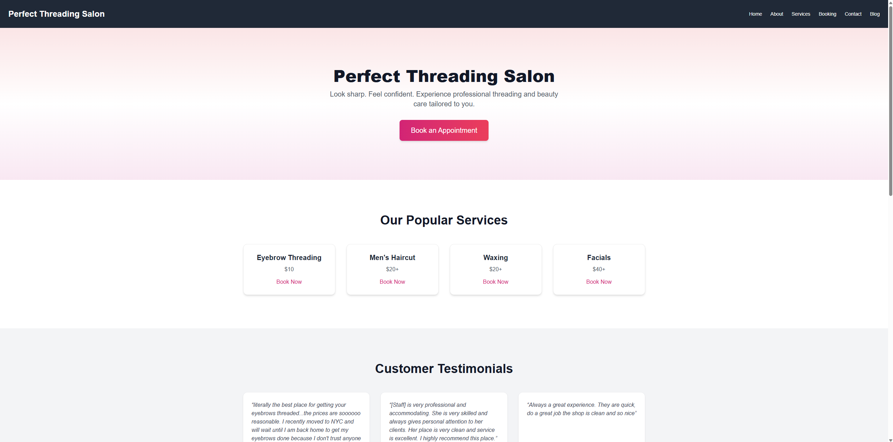

Perfect Threading Salon   
- A website built for a local salon using **Next.js 14**, **Tailwind CSS**, and **TypeScript**, featuring clean UI, service booking for haircuts (to mor eeffectively manage customer traffic), and informational blog content.

 
---

🔗 Live Site  
[https://perfect-threading.vercel.app](https://perfect-threading.vercel.app)

---

🧠 Features

- 💇 **Dedicated service pages** (e.g. threading, waxing, facials) with pricing 
- 📆 **Booking system** using Calendly embeds for hassle-free scheduling
- 🧾 **Informational blog** with skincare and grooming guides
- 📱 **Fully responsive design** across desktop and mobile

---

## ⚙️ Tech Stack

| Tech           | Purpose                              |
|----------------|--------------------------------------|
| Next.js 14     | Fullstack React framework            |
| TypeScript     | Type-safe development                |
| Tailwind CSS   | Utility-first styling framework      |
| Framer Motion  | Animations and transitions           |
| Vercel         | Deployment platform                  |
| Calendly       | Thirdparty booking system integration |

---

📁 File Structure

/app

page.tsx # Main landing page

services/ # Service-specific pages (threading, waxing, etc.)

booking.tsx # Booking page with Calendly

blog/ # Informational articles

/components

Header.tsx # Navigation component

ServiceCard.tsx # Reusable service info cards

/public/images

threading.jpg

waxing.jpg

facial.jpg

